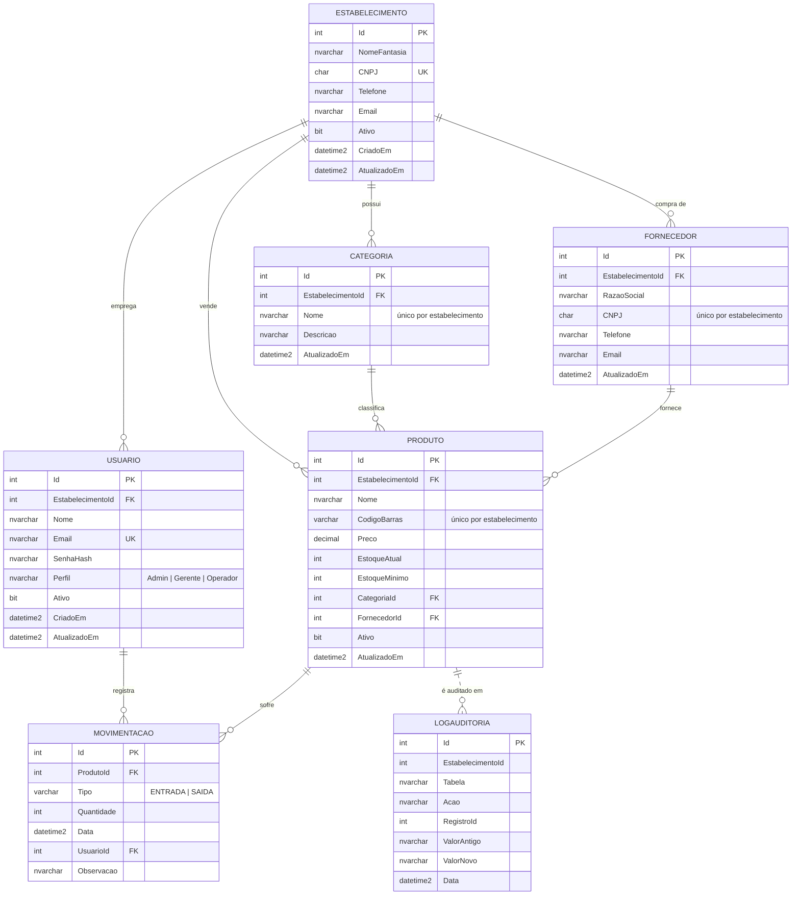

# MER / DER — StockControl

Modelo Entidade-Relacionamento do banco do StockControl, sistema de controle de estoque para **vários estabelecimentos** (mercadinhos) no mesmo banco.
O diagrama está em [Mermaid](https://mermaid.js.org/) e aparece desenhado no GitHub e no VS Code (extensão *Markdown Preview Mermaid Support*). Para colocar a imagem no relatório, cole o código em <https://mermaid.live> e exporte em PNG/SVG.

## Entidades

| Entidade | O que representa |
|---|---|
| **Estabelecimento** | Mercadinho que usa o sistema. É criado pela tela "Cadastrar meu estabelecimento", junto com o dono (primeiro usuário, perfil Admin). |
| **Usuario** | Pessoa que acessa o sistema; trabalha em um estabelecimento. O perfil define o que ela pode fazer. |
| **Categoria** | Agrupamento de produtos de um estabelecimento (Mercearia, Bebidas, Limpeza...). |
| **Fornecedor** | Empresa que vende os produtos para o estabelecimento. |
| **Produto** | Item vendido pelo estabelecimento, com preço, estoque atual e estoque mínimo. |
| **Movimentacao** | Entrada (compra/reposição) ou saída (venda) de um produto. **Venda = movimentação do tipo SAIDA.** |
| **LogAuditoria** | Histórico de alterações de preço e exclusões de produto, gravado automaticamente por trigger. |

## Relacionamentos e cardinalidades

| Relacionamento | Cardinalidade | Leitura |
|---|---|---|
| Estabelecimento — Usuario | 1 : N | Um estabelecimento tem vários usuários (o dono e os funcionários); cada usuário trabalha em um estabelecimento. |
| Estabelecimento — Categoria / Fornecedor / Produto | 1 : N | Cada estabelecimento tem os próprios cadastros; cada cadastro pertence a um único estabelecimento. |
| Categoria — Produto | 1 : N | Uma categoria classifica vários produtos; cada produto tem exatamente uma categoria. |
| Fornecedor — Produto | 1 : N | Um fornecedor fornece vários produtos; cada produto tem exatamente um fornecedor. |
| Produto — Movimentacao | 1 : N | Um produto pode ter várias movimentações; cada movimentação é de um único produto. |
| Usuario — Movimentacao | 1 : N | Um usuário registra várias movimentações; cada movimentação foi feita por um usuário. |
| Produto — LogAuditoria | 1 : N (lógico) | A ligação é pelo campo `RegistroId` e **não é uma FK de propósito**: o log precisa continuar existindo depois que o produto é excluído. Por isso a linha é tracejada no diagrama. |

**Por que Movimentacao não tem EstabelecimentoId?** O estabelecimento de uma movimentação é o do produto movimentado. Guardar de novo seria repetir informação, o que fere a 3ª Forma Normal e abre a chance de inconsistência.

## Regras de negócio garantidas pelo banco

- **Cada estabelecimento só vê e só altera os próprios dados.** As procedures recebem `@EstabelecimentoId`, e a aplicação aplica um filtro automático em todas as consultas.
- O **e-mail do usuário** (login) e o **CNPJ do estabelecimento** não se repetem no sistema inteiro.
- O **código de barras**, o **CNPJ do fornecedor** e o **nome da categoria** não se repetem **dentro do mesmo estabelecimento**, mas podem se repetir entre estabelecimentos diferentes (dois mercadinhos vendem o mesmo arroz e compram do mesmo distribuidor).
- Perfil só pode ser `Admin`, `Gerente` ou `Operador`; tipo da movimentação só `ENTRADA` ou `SAIDA`.
- A quantidade movimentada é sempre maior que zero.
- O estoque nunca fica negativo: a procedure `sp_RegistrarMovimentacao` valida antes de gravar e, como segunda barreira, o `CHECK (EstoqueAtual >= 0)` impede o valor negativo.
- O estoque é atualizado **somente** pela trigger `trg_AtualizaEstoque`, nunca à mão.
