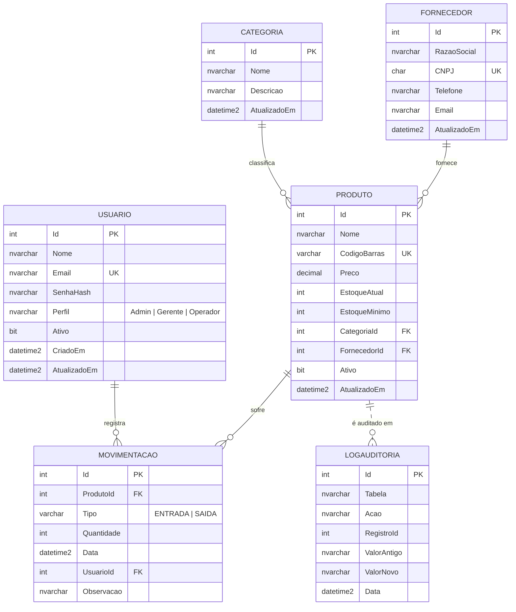

# MER / DER — StockControl

Modelo Entidade-Relacionamento do banco do StockControl (sistema de controle de estoque de um mercadinho).
O diagrama está em [Mermaid](https://mermaid.js.org/) e aparece desenhado no GitHub e no VS Code (extensão *Markdown Preview Mermaid Support*). Para colocar a imagem no relatório, cole o código em <https://mermaid.live> e exporte em PNG/SVG.

## Entidades

| Entidade | O que representa |
|---|---|
| **Usuario** | Pessoa que acessa o sistema web ou o app. O perfil define o que ela pode fazer. |
| **Categoria** | Agrupamento de produtos (Mercearia, Bebidas, Limpeza...). |
| **Fornecedor** | Empresa que vende os produtos para o mercadinho. |
| **Produto** | Item vendido, com preço, estoque atual e estoque mínimo. |
| **Movimentacao** | Entrada (compra/reposição) ou saída (venda) de um produto. **Venda = movimentação do tipo SAIDA.** |
| **LogAuditoria** | Histórico de alterações de preço e exclusões de produto, gravado automaticamente por trigger. |

## Relacionamentos e cardinalidades

| Relacionamento | Cardinalidade | Leitura |
|---|---|---|
| Categoria — Produto | 1 : N | Uma categoria classifica vários produtos; cada produto tem exatamente uma categoria. |
| Fornecedor — Produto | 1 : N | Um fornecedor fornece vários produtos; cada produto tem exatamente um fornecedor. |
| Produto — Movimentacao | 1 : N | Um produto pode ter várias movimentações; cada movimentação é de um único produto. |
| Usuario — Movimentacao | 1 : N | Um usuário registra várias movimentações; cada movimentação foi feita por um usuário. |
| Produto — LogAuditoria | 1 : N (lógico) | Um produto pode ter vários registros de log. A ligação é pelo campo `RegistroId` e **não é uma FK de propósito**: o log precisa continuar existindo depois que o produto é excluído. Por isso a linha é tracejada no diagrama. |

## Regras de negócio garantidas pelo banco

- E-mail do usuário, CNPJ do fornecedor e código de barras do produto não se repetem (índices únicos).
- Perfil só pode ser `Admin`, `Gerente` ou `Operador`; tipo da movimentação só `ENTRADA` ou `SAIDA`.
- A quantidade movimentada é sempre maior que zero.
- O estoque nunca fica negativo: a procedure `sp_RegistrarMovimentacao` valida antes de gravar e, como segunda barreira, o `CHECK (EstoqueAtual >= 0)` impede o valor negativo.
- O estoque é atualizado **somente** pela trigger `trg_AtualizaEstoque`, nunca à mão.
