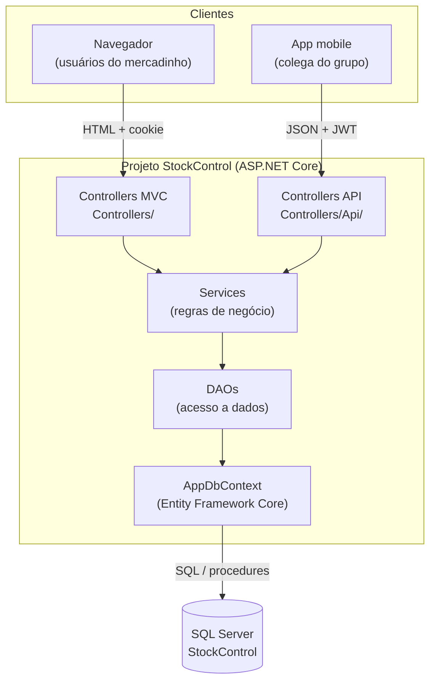
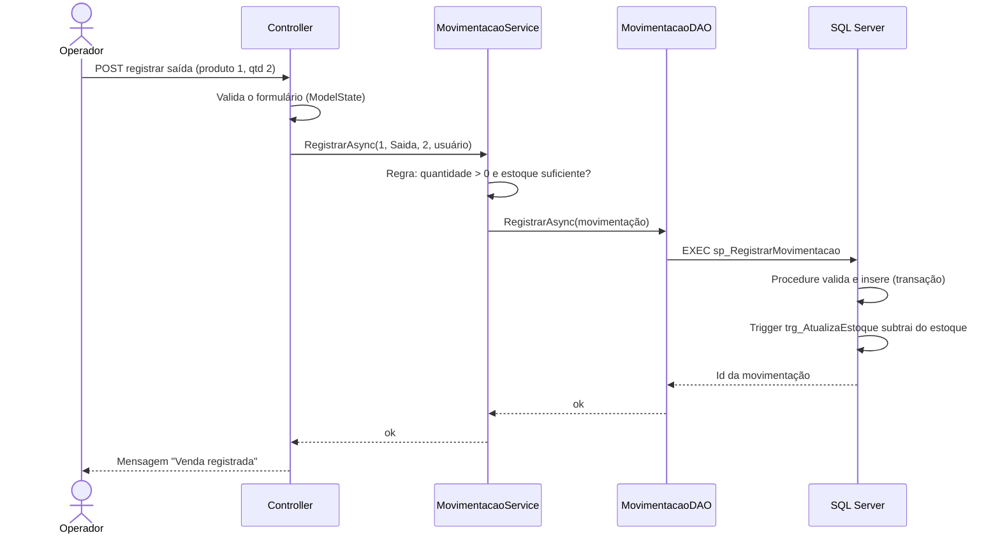

# 1. Visão geral e arquitetura

## 1.1 O sistema

O **StockControl** é um sistema de controle de estoque desenvolvido para um mercadinho. Ele permite cadastrar produtos, categorias, fornecedores e usuários, registrar entradas de mercadoria e vendas (saídas), acompanhar os produtos que precisam de reposição e consultar o histórico de movimentações.

O sistema é composto por três partes que trabalham juntas:

| Módulo | Quem usa | Tecnologia |
|---|---|---|
| **Sistema Web** | Administrador, gerente e operador do mercadinho, pelo navegador | ASP.NET Core MVC (Razor) |
| **API REST** | Aplicativo mobile do grupo | ASP.NET Core Web API (mesmo projeto do sistema web) |
| **Banco de dados** | Sistema web e API | Microsoft SQL Server |

O aplicativo mobile não acessa o banco diretamente: ele consome a API REST, que aplica as mesmas regras de negócio do sistema web. Assim, web e mobile trabalham sobre os **mesmos dados** e as **mesmas regras**.

## 1.2 Tecnologias utilizadas

| Tecnologia | Versão | Para que foi usada |
|---|---|---|
| C# / .NET | 8 (LTS) | Linguagem e plataforma do back-end |
| ASP.NET Core MVC | 8 | Sistema web: controllers e telas (Views Razor) |
| ASP.NET Core Web API | 8 | Endpoints JSON consumidos pelo app mobile |
| Entity Framework Core | 8 | Mapeamento objeto-relacional (ORM) via Fluent API |
| Microsoft SQL Server Express | 2025 | Banco de dados relacional |
| SQL Server Management Studio (SSMS) | 22 | Execução do script e administração do banco |
| BCrypt.Net-Next | 4.0.3 | Hash de senhas |
| JWT Bearer (Microsoft.AspNetCore.Authentication.JwtBearer) | 8 | Autenticação da API por token |
| Swashbuckle (Swagger / OpenAPI) | 6.6.2 | Documentação interativa da API |
| HTML5, CSS3, JavaScript | — | Interface (sem frameworks de CSS/JS) |

## 1.3 Arquitetura em camadas

O sistema segue uma **arquitetura em camadas**, em que cada camada tem uma responsabilidade única e só conversa com a camada imediatamente abaixo:



| Camada | Pasta | Responsabilidade |
|---|---|---|
| **Apresentação (MVC)** | `Controllers/`, `Views/`, `ViewModels/` | Recebe as requisições do navegador, valida os dados do formulário e devolve a tela HTML. |
| **API** | `Controllers/Api/` | Recebe as requisições do app mobile e devolve JSON. |
| **Negócio** | `Services/` | Aplica as regras do mercadinho (ex.: não vender mais do que há em estoque, não repetir código de barras). |
| **Acesso a dados** | `DAO/` | Executa consultas, inserções, alterações e exclusões no banco, e chama as procedures. |
| **Mapeamento** | `Data/` | `AppDbContext` e as classes de configuração (Fluent API) que ligam as classes C# às tabelas. |
| **Modelo** | `Models/` | Entidades do domínio (Produto, Categoria...). |
| **Banco** | `database/` | Script SQL com tabelas, índices, procedures, triggers e dados de teste. |

**Vantagens dessa organização:**
- **Separação de responsabilidades:** uma mudança na tela não afeta a regra de negócio, e uma mudança no banco fica isolada nos DAOs.
- **Reaproveitamento:** os Controllers MVC e os Controllers da API usam os **mesmos Services**. A regra "não vender sem estoque" foi escrita uma vez só e vale para web e mobile.
- **Facilidade de manutenção e de testes:** cada classe tem uma função clara e pequena.

## 1.4 Fluxo de uma requisição

Exemplo: o operador registra uma venda de 2 pacotes de arroz.



## 1.5 Integração entre os módulos

- **Web ↔ Banco:** pelo Entity Framework Core, através dos DAOs. O banco é criado pelo script SQL e o EF apenas mapeia as tabelas existentes (não são usadas *migrations*).
- **Mobile ↔ Banco:** o app nunca acessa o banco. Ele chama a API REST (JSON sobre HTTPS), autenticando-se com um token **JWT**.
- **Regras de negócio em dois níveis:** as regras ficam nos Services (C#) e as mais críticas são repetidas no banco (procedure, trigger e `CHECK`). Assim, mesmo um acesso direto ao banco não consegue, por exemplo, deixar o estoque negativo.
- **Sincronização do mobile:** cada cadastro tem a coluna `AtualizadoEm`. O app pede à API somente os produtos alterados desde a última sincronização (`GET /api/produtos?atualizadoDesde=...`).

## 1.6 Estrutura de pastas

```
PIM-4/
├── database/
│   └── script_stockcontrol.sql      → banco completo (modelo físico)
├── docs/                            → MER, modelo lógico e textos do relatório
└── StockControl/                    → projeto ASP.NET Core
    ├── Controllers/                 → MVC (telas)
    │   └── Api/                     → API REST (mobile)
    ├── DAO/                         → interfaces e classes de acesso a dados
    ├── Data/
    │   ├── AppDbContext.cs
    │   └── Configurations/          → Fluent API (uma classe por tabela)
    ├── Excecoes/                    → RegraNegocioException
    ├── Extensions/                  → métodos auxiliares (usuário logado)
    ├── Models/                      → entidades
    │   └── Consultas/               → resultados de procedures e do dashboard
    ├── Services/                    → regras de negócio
    ├── ViewModels/                  → dados de cada tela
    ├── Views/                       → telas Razor
    ├── wwwroot/                     → CSS e JavaScript
    ├── appsettings.json             → configuração (conexão com o banco)
    └── Program.cs                   → inicialização e injeção de dependência
```
