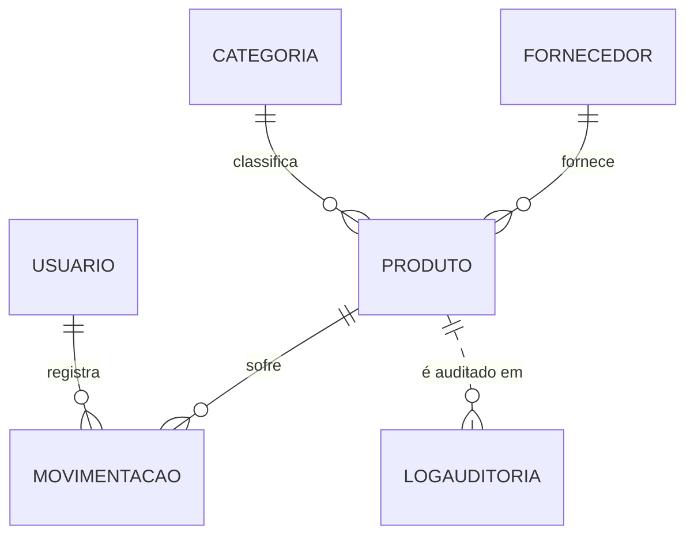

# 2. Banco de dados

## 2.1 Visão geral

O banco de dados do StockControl roda no **Microsoft SQL Server** (edição Express 2025) e se chama `StockControl`. Ele é usado pelo sistema web e, por meio da API, pelo aplicativo mobile.

O banco é criado **por um único script SQL** ([`database/script_stockcontrol.sql`](../../database/script_stockcontrol.sql)), que é o **modelo físico** do sistema. O Entity Framework Core, usado na aplicação, **não cria nem altera** tabelas (não são usadas *migrations*): ele apenas mapeia as tabelas criadas pelo script.

**Por que um script único em vez de migrations?**
- O script mostra de forma explícita e completa tudo o que existe no banco: tabelas, chaves, restrições, índices, procedures, triggers e dados de teste.
- Procedures e triggers são escritas diretamente em T-SQL, o que não seria natural com migrations.
- O banco pode ser recriado do zero em qualquer máquina com um único comando (F5 no SSMS).

O script é organizado nesta ordem:
1. `CREATE DATABASE` / `USE`
2. `CREATE TABLE` com chaves primárias, estrangeiras e restrições (`UNIQUE`, `CHECK`, `DEFAULT`)
3. Índices
4. Procedures
5. Triggers
6. Dados de teste (seed)
7. Comandos de teste comentados

## 2.2 Modelo conceitual (MER)

O diagrama completo está em [`docs/mer.md`](../mer.md).



| Entidade | Descrição |
|---|---|
| **Usuario** | Pessoa que acessa o sistema; o perfil (Admin, Gerente, Operador) define as permissões. |
| **Categoria** | Agrupamento de produtos (Mercearia, Bebidas, Limpeza...). |
| **Fornecedor** | Empresa que fornece os produtos ao mercadinho. |
| **Produto** | Item vendido, com preço, estoque atual e estoque mínimo. |
| **Movimentacao** | Entrada (compra/reposição) ou saída (venda) de um produto. Uma **venda é uma movimentação do tipo SAIDA**. |
| **LogAuditoria** | Histórico automático de alterações de preço e exclusões de produtos. |

**Relacionamentos:**
- Uma **categoria** classifica vários produtos; cada produto pertence a uma categoria (1:N).
- Um **fornecedor** fornece vários produtos; cada produto tem um fornecedor (1:N).
- Um **produto** possui várias movimentações; cada movimentação refere-se a um produto (1:N).
- Um **usuário** registra várias movimentações; cada movimentação foi feita por um usuário (1:N).
- **LogAuditoria** guarda o Id do produto (`RegistroId`) **sem chave estrangeira**, de propósito: o histórico precisa continuar existindo mesmo depois que o produto é excluído.

## 2.3 Modelo lógico

O detalhamento de todas as colunas, tipos, chaves e restrições está em [`docs/modelo-logico.md`](../modelo-logico.md). Resumo:

| Tabela | Chave primária | Chaves estrangeiras | Únicos | Principais restrições (CHECK) |
|---|---|---|---|---|
| Usuario | Id | — | Email | Perfil ∈ {Admin, Gerente, Operador}; formato de e-mail |
| Categoria | Id | — | — | — |
| Fornecedor | Id | — | CNPJ | CNPJ com 14 dígitos numéricos |
| Produto | Id | CategoriaId, FornecedorId | CodigoBarras | Preço ≥ 0; EstoqueAtual ≥ 0; EstoqueMinimo ≥ 0 |
| Movimentacao | Id | ProdutoId, UsuarioId | — | Tipo ∈ {ENTRADA, SAIDA}; Quantidade > 0 |
| LogAuditoria | Id | — | — | — |

**Decisões de tipos de dados:**
- `INT IDENTITY` nas chaves primárias: o próprio banco gera o número.
- `NVARCHAR` nos textos, para aceitar acentos (ex.: "Açúcar", "Feijão").
- `DECIMAL(10,2)` no preço: valores monetários exatos (tipos como `FLOAT` causam erros de arredondamento).
- `CHAR(14)` no CNPJ: tamanho fixo, guardado só com os números (a máscara é aplicada na tela).
- `DATETIME2` nas datas: mais precisão e intervalo maior que o antigo `DATETIME`.
- `BIT` em `Ativo`: verdadeiro/falso.

### Normalização

O modelo está na **3ª Forma Normal (3FN)**:
- **1FN:** todas as colunas são atômicas (um único valor por campo).
- **2FN:** as chaves primárias são simples, então não há dependência parcial.
- **3FN:** não há dependência transitiva. Por exemplo, o nome da categoria fica apenas em `Categoria`; `Produto` guarda somente `CategoriaId`.

**Desnormalização controlada:** `Produto.EstoqueAtual` poderia ser calculado somando todas as movimentações, mas é armazenado para que o dashboard e o app consultem o estoque instantaneamente. A consistência é garantida pela trigger `trg_AtualizaEstoque`, a única responsável por alterar essa coluna.

## 2.4 Modelo físico

O modelo físico é o próprio script. Exemplo da tabela `Produto`:

```sql
CREATE TABLE Produto (
    Id            INT IDENTITY(1,1) NOT NULL,
    Nome          NVARCHAR(120)     NOT NULL,
    CodigoBarras  VARCHAR(20)       NOT NULL,
    Preco         DECIMAL(10,2)     NOT NULL,
    EstoqueAtual  INT               NOT NULL CONSTRAINT DF_Produto_EstoqueAtual DEFAULT 0,
    EstoqueMinimo INT               NOT NULL CONSTRAINT DF_Produto_EstoqueMinimo DEFAULT 0,
    CategoriaId   INT               NOT NULL,
    FornecedorId  INT               NOT NULL,
    Ativo         BIT               NOT NULL CONSTRAINT DF_Produto_Ativo        DEFAULT 1,
    AtualizadoEm  DATETIME2         NOT NULL CONSTRAINT DF_Produto_AtualizadoEm DEFAULT SYSDATETIME(),

    CONSTRAINT PK_Produto            PRIMARY KEY (Id),
    CONSTRAINT FK_Produto_Categoria  FOREIGN KEY (CategoriaId)  REFERENCES Categoria (Id),
    CONSTRAINT FK_Produto_Fornecedor FOREIGN KEY (FornecedorId) REFERENCES Fornecedor (Id),
    CONSTRAINT CK_Produto_Preco         CHECK (Preco >= 0),
    CONSTRAINT CK_Produto_EstoqueAtual  CHECK (EstoqueAtual >= 0),
    CONSTRAINT CK_Produto_EstoqueMinimo CHECK (EstoqueMinimo >= 0)
);
```

Todas as restrições têm **nome explícito** (`PK_`, `FK_`, `CK_`, `DF_`, `UX_`, `IX_`), o que facilita entender as mensagens de erro e dar manutenção.

## 2.5 Procedures (procedimentos armazenados)

### `sp_RegistrarMovimentacao`
Registra uma entrada ou uma saída de estoque. É a forma oficial de movimentar o estoque, usada pelo sistema web e pela API.

1. Valida o tipo (`ENTRADA`/`SAIDA`), a quantidade (> 0) e se o usuário existe e está ativo.
2. Abre uma **transação**.
3. Lê o estoque do produto com **bloqueio da linha** (`WITH (UPDLOCK, HOLDLOCK)`). Se duas vendas do mesmo produto chegarem ao mesmo tempo (por exemplo, uma pela web e outra pelo celular), a segunda espera a primeira terminar. Isso evita vender um produto que já acabou.
4. Na saída, verifica se há estoque suficiente; se não houver, gera o erro 50005 "Estoque insuficiente".
5. Insere a movimentação e confirma a transação (`COMMIT`). Em qualquer erro, desfaz tudo (`ROLLBACK`).
6. Devolve o Id da movimentação criada.

A procedure **não altera o estoque**: quem faz isso é a trigger `trg_AtualizaEstoque`. Se as duas atualizassem, o estoque seria contado duas vezes.

Erros personalizados (`THROW`), convertidos em mensagens amigáveis na aplicação:

| Código | Mensagem |
|---|---|
| 50001 | Produto inexistente ou inativo. |
| 50002 | Usuário inexistente ou inativo. |
| 50003 | Tipo de movimentação inválido. |
| 50004 | A quantidade deve ser maior que zero. |
| 50005 | Estoque insuficiente para esta saída. |

### `sp_ProdutosAbaixoDoMinimo`
Lista os produtos ativos cujo `EstoqueAtual` é menor que o `EstoqueMinimo`, com a quantidade que falta para chegar ao mínimo. É usada no **dashboard** como alerta de reposição.

### `sp_RelatorioMovimentacoes`
Recebe `@DataInicio` e `@DataFim` e devolve as movimentações do período (os dois dias inclusos), com o nome do produto e do usuário. É usada na tela e no relatório de movimentações.

## 2.6 Triggers (gatilhos)

### `trg_AtualizaEstoque` — `AFTER INSERT` em `Movimentacao`
Após cada movimentação inserida, soma a quantidade ao estoque (ENTRADA) ou subtrai (SAIDA) e atualiza `AtualizadoEm` do produto.

```sql
UPDATE p
SET p.EstoqueAtual = p.EstoqueAtual + t.Variacao,
    p.AtualizadoEm = SYSDATETIME()
FROM Produto p
INNER JOIN (
    SELECT ProdutoId,
           SUM(CASE WHEN Tipo = 'ENTRADA' THEN Quantidade ELSE -Quantidade END) AS Variacao
    FROM inserted
    GROUP BY ProdutoId
) t ON t.ProdutoId = p.Id;
```

A trigger trabalha com **conjuntos** (`inserted` + `GROUP BY`), e não com uma linha só, então funciona mesmo quando um único comando insere várias movimentações. Se o resultado deixasse o estoque negativo, a restrição `CK_Produto_EstoqueAtual` falharia e toda a operação seria desfeita: é uma **segunda barreira** de segurança, além da procedure.

### `trg_AuditoriaProduto` — `AFTER UPDATE, DELETE` em `Produto`
Grava em `LogAuditoria`:
- **`UPDATE_PRECO`:** quando o preço muda, com o valor antigo e o novo.
- **`DELETE`:** quando um produto é excluído, com os dados que ele tinha.

Como a trigger de estoque também faz `UPDATE` em `Produto`, a auditoria filtra apenas as linhas em que o preço realmente mudou (`WHERE i.Preco <> d.Preco`), evitando registros desnecessários a cada venda.

## 2.7 Índices (otimização)

| Índice | Coluna | Tipo | Motivo |
|---|---|---|---|
| UX_Produto_CodigoBarras | Produto.CodigoBarras | Único | Busca rápida pelo leitor de código de barras; impede duplicados |
| UX_Usuario_Email | Usuario.Email | Único | Login; impede e-mail repetido |
| UX_Fornecedor_CNPJ | Fornecedor.CNPJ | Único | Impede fornecedor duplicado |
| IX_Produto_CategoriaId / IX_Produto_FornecedorId | FKs de Produto | Comum | Acelera JOINs |
| IX_Movimentacao_ProdutoId / IX_Movimentacao_UsuarioId | FKs de Movimentacao | Comum | Acelera JOINs e o histórico do produto |
| IX_Movimentacao_Data | Movimentacao.Data | Comum | Relatório por período |
| IX_Produto_AtualizadoEm | Produto.AtualizadoEm | Comum | Sincronização do app mobile |

O SQL Server cria índice automaticamente só para a chave primária; as chaves estrangeiras **não** recebem índice sozinhas, por isso eles foram criados no script.

## 2.8 Dados de teste (seed)

O script insere:
- **3 usuários**, um de cada perfil (senhas guardadas como hash BCrypt);
- **5 categorias** e **3 fornecedores** (CNPJs fictícios com dígitos verificadores válidos);
- **15 produtos** de mercadinho, começando com estoque zero;
- **38 movimentações** dos últimos 30 dias (16 entradas e 22 vendas), registradas **pela própria procedure**. O estoque inicial é formado pelas triggers, exatamente como no uso real do sistema.

Depois do seed, 5 produtos ficam abaixo do mínimo (Feijão, Café, Água, Leite e Detergente), o que permite demonstrar o alerta do dashboard.

| Usuário | Perfil |
|---|---|
| admin@stockcontrol.local | Admin |
| gerente@stockcontrol.local | Gerente |
| operador@stockcontrol.local | Operador |

## 2.9 Integração com a aplicação (Entity Framework Core)

- A classe `AppDbContext` possui um `DbSet<T>` para cada tabela.
- O mapeamento é feito por **Fluent API**, com uma classe de configuração por tabela (`IEntityTypeConfiguration<T>`) usando `ToTable`, `HasKey`, `IsRequired`, `HasMaxLength`, `HasPrecision` e os relacionamentos (`HasOne`/`WithMany`).
- **Triggers e EF Core:** a partir do EF Core 7, o EF usa um comando de gravação que não é compatível com tabelas que têm trigger. Por isso, as tabelas com trigger são declaradas assim:

  ```csharp
  builder.ToTable("Movimentacao", tb => tb.HasTrigger("trg_AtualizaEstoque"));
  builder.ToTable("Produto",      tb => tb.HasTrigger("trg_AuditoriaProduto"));
  ```

- As procedures são chamadas com strings interpoladas, que o EF converte em **parâmetros SQL**, evitando *SQL Injection*:

  ```csharp
  _contexto.Database.SqlQuery<IdGerado>($@"EXEC sp_RegistrarMovimentacao
      @ProdutoId = {movimentacao.ProdutoId}, @Tipo = {tipo}, ...")
  ```

- A coluna `EstoqueAtual` foi configurada para **nunca ser enviada em um UPDATE** pelo EF (`SetAfterSaveBehavior(Ignore)`), garantindo que só a trigger altere o estoque.

## 2.10 Como criar o banco

1. Abrir o SSMS e conectar em `localhost\SQLEXPRESS` (Autenticação do Windows, com "Certificado do Servidor de Confiança" marcado).
2. Abrir `database/script_stockcontrol.sql`.
3. Executar com **F5**.

O script pode ser executado novamente para recriar o banco do zero, mas **apaga todos os dados**.
