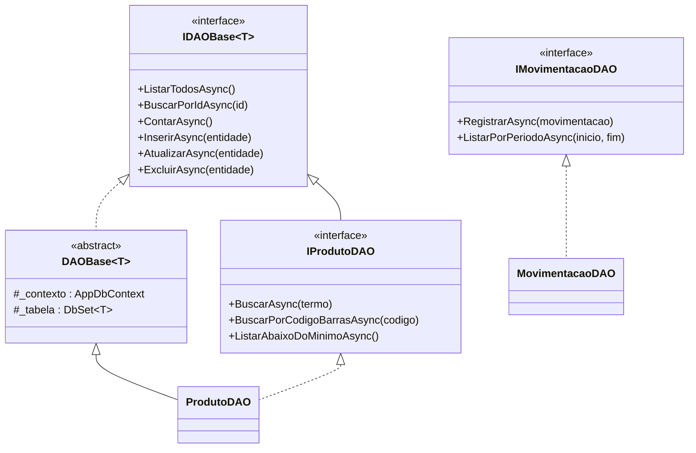
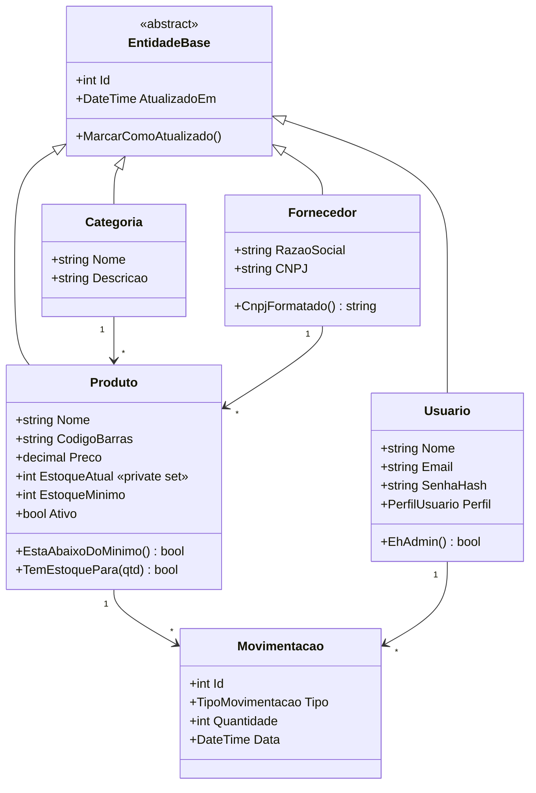

# 3. Back-end

## 3.1 Visão geral

O back-end foi desenvolvido em **C# com ASP.NET Core 8**, em um único projeto que atende tanto o sistema web (padrão **MVC**) quanto o aplicativo mobile (**Web API**). O código é organizado em camadas, e cada camada só conversa com a camada imediatamente abaixo:

**Controller → Service → DAO → AppDbContext → SQL Server**

## 3.2 Camadas

### Controllers (apresentação)
Recebem a requisição HTTP, validam os dados de entrada (`ModelState`), chamam o Service e devolvem a resposta: uma tela HTML (MVC) ou JSON (API). Os Controllers **não** contêm regras de negócio nem acessam o banco.

| Controller | Função | Quem acessa |
|---|---|---|
| `ContaController` | Login, logout, acesso negado e **cadastro de um novo estabelecimento** | Todos (login e cadastro sem autenticação) |
| `EstabelecimentoController` | "Meu estabelecimento": dados do mercadinho | Somente Admin |
| `AuditoriaController` | Histórico de mudanças de preço e exclusões gravado pela trigger | Somente Admin |
| `ContaController` → `MinhaConta` | Dados do usuário logado e troca da própria senha | Usuários logados |
| `HomeController` | Dashboard (totais, reposição, últimas movimentações) | Usuários logados |
| `MovimentacoesController` | Registrar entrada/venda e listar por período | Usuários logados |
| `ProdutosController` | Listagem com busca e CRUD de produtos | Consulta: todos; cadastro/edição/exclusão: Admin e Gerente |
| `CategoriasController` | CRUD de categorias | Admin e Gerente |
| `FornecedoresController` | CRUD de fornecedores | Admin e Gerente |
| `UsuariosController` | CRUD de usuários (estrutura administrativa) | Somente Admin |

Os controllers da API REST (`Controllers/Api/`) herdam de `ApiControllerBase`, usam autenticação JWT e devolvem JSON. Eles estão descritos em [06-api-rest.md](06-api-rest.md).

### DTOs (API)
Os *Data Transfer Objects* (`Dtos/`) são os objetos que a API recebe e devolve em JSON (ex.: `ProdutoDto`, `ProdutoRequisicao`, `LoginResposta`). Eles têm o mesmo papel dos ViewModels nas telas: validar a entrada e controlar o que sai, sem expor dados sensíveis como o hash da senha.

### ViewModels
Classes com os dados de cada tela (ex.: `ProdutoFormViewModel`, `LoginViewModel`). Elas contêm as **regras de validação de entrada** com *DataAnnotations* (`[Required]`, `[StringLength]`, `[Range]`, `[EmailAddress]`, `[RegularExpression]`) e controlam exatamente quais campos o usuário pode enviar. Isso evita, por exemplo, que alguém altere o estoque de um produto enviando um campo extra no formulário (*overposting*).

### Services (regras de negócio)
Cada Service tem uma **interface** (`IProdutoService`) e uma **implementação** (`ProdutoService`). Os Services concentram as regras do mercadinho:

| Service | Principais regras |
|---|---|
| `ProdutoService` | Código de barras não pode se repetir; categoria e fornecedor precisam existir; preço e estoque mínimo não podem ser negativos; o estoque inicial vira uma movimentação de ENTRADA; produto com histórico é **desativado** em vez de excluído. |
| `MovimentacaoService` | Quantidade maior que zero; produto ativo; **saída não pode ser maior que o estoque**; período do relatório válido. |
| `CategoriaService` | Nome obrigatório e único; não exclui categoria que tenha produtos. |
| `FornecedorService` | Remove a máscara do CNPJ e **valida os dígitos verificadores**; CNPJ único; não exclui fornecedor que tenha produtos. |
| `UsuarioService` | Senha com no mínimo 6 caracteres, guardada com hash BCrypt; e-mail único e sempre minúsculo; o sistema não pode ficar sem administrador ativo; o usuário não pode desativar nem excluir a si mesmo; usuário que já registrou movimentações é **desativado** em vez de excluído (o histórico precisa mostrar quem fez cada venda); na edição, senha em branco mantém a atual. |
| `AuditoriaService` | Monta a tela de Auditoria a partir do `LogAuditoria`: traduz a ação ("Alteração de preço" / "Exclusão de produto"), formata os preços gravados pela trigger (`28.90` → R$ 28,90) e, para produtos já excluídos, recupera o nome do próprio log. |
| `UsuarioService.AlterarMinhaSenhaAsync` | Troca da própria senha: exige a **senha atual** correta, a nova precisa ter 6+ caracteres e ser diferente da atual. |
| `EstabelecimentoService` | Cadastro de mercadinho novo: CNPJ válido e ainda não usado, e-mail do dono ainda não usado, senha com no mínimo 6 caracteres; o dono vira Admin; cria 6 categorias iniciais; tudo em uma transação. Edição do nome, telefone e e-mail (o CNPJ não muda). |
| `DashboardService` | Monta os indicadores do painel: vendas de hoje em R$ e em itens, vendas dos últimos 7 dias (completando com zero os dias sem venda, para o gráfico), **top 5 mais vendidos** dos últimos 30 dias (consulta com `GROUP BY` no banco), produtos abaixo do mínimo, valor em estoque e as últimas movimentações. O valor de cada venda é quantidade × preço atual do produto. |

Quando uma regra é violada, o Service lança uma `RegraNegocioException` com uma mensagem amigável. O Controller captura essa exceção e mostra a mensagem na tela (ou devolve no JSON).

### DAO — Data Access Object (acesso a dados)
O padrão **DAO** isola todo o acesso ao banco em classes próprias. Os Services não sabem *como* os dados são gravados: só chamam métodos como `BuscarPorCodigoBarrasAsync`.



- `IDAOBase<T>` / `DAOBase<T>`: CRUD genérico, escrito uma única vez e herdado por `ProdutoDAO`, `CategoriaDAO`, `FornecedorDAO` e `UsuarioDAO`.
- Cada DAO específico acrescenta suas consultas (ex.: `ProdutoDAO.ListarAbaixoDoMinimoAsync()` chama a procedure `sp_ProdutosAbaixoDoMinimo`).
- `LogAuditoriaDAO` só **lê** o `LogAuditoria` (quem grava é a trigger); a tabela não tem tela de edição nem exclusão.
- `EstabelecimentoDAO` faz o cadastro do estabelecimento, do dono e das categorias iniciais **em uma única transação** (`BeginTransactionAsync` / `CommitAsync`).
- Todos os DAOs passam pelo **filtro automático por estabelecimento** do `AppDbContext`. Só o login e a checagem de e-mail/CNPJ únicos usam `IgnoreQueryFilters()` (ver [10-multiestabelecimento.md](10-multiestabelecimento.md)).
- `MovimentacaoDAO` **não** herda o CRUD genérico: uma movimentação é histórica e não pode ser editada nem excluída. Ela é registrada pela procedure `sp_RegistrarMovimentacao`.
- Os erros lançados pela procedure (`THROW 50005 'Estoque insuficiente'`) são convertidos em `RegraNegocioException`.

### Data (mapeamento)
`AppDbContext` e as classes em `Data/Configurations` fazem o mapeamento das classes C# para as tabelas do banco por **Fluent API**. Detalhes em [02-banco-de-dados.md](02-banco-de-dados.md#29-integração-com-a-aplicação-entity-framework-core).

## 3.3 Programação Orientada a Objetos

| Conceito | Onde aparece no código |
|---|---|
| **Abstração** | `EntidadeBase` é `abstract`: representa o que toda entidade de cadastro tem em comum, mas não pode ser instanciada sozinha. `DAOBase<T>` também é abstrata. |
| **Herança** | `Usuario`, `Categoria`, `Fornecedor` e `Produto` herdam `Id` e `AtualizadoEm` de `EntidadeBase`. `ProdutoDAO`, `CategoriaDAO`, `FornecedorDAO` e `UsuarioDAO` herdam o CRUD de `DAOBase<T>`. |
| **Encapsulamento** | `Produto.EstoqueAtual` tem `private set`: nenhum código C# consegue alterar o estoque diretamente; ele só muda por movimentação. `EntidadeBase.AtualizadoEm` tem `protected set` e só é alterada pelo método `MarcarComoAtualizado()`. Os DAOs guardam o `DbContext` em campos `protected readonly`. |
| **Polimorfismo** | Os métodos de `DAOBase<T>` são `virtual` e são sobrescritos (`override`) pelos DAOs filhos. Por exemplo, `ProdutoDAO.ListarTodosAsync()` também carrega a categoria e o fornecedor. Os Services trabalham com interfaces (`IProdutoDAO`), sem depender da classe concreta. |
| **Interfaces** | Todo Service e todo DAO tem uma interface (`IProdutoService`, `IProdutoDAO`...). A interface `IPertenceAEstabelecimento` é implementada por `Usuario`, `Categoria`, `Fornecedor` e `Produto`: o `AppDbContext` trata todas elas da mesma forma ao preencher o estabelecimento (polimorfismo por interface). |
| **Classe estática** | `Cnpj` reúne limpeza, formatação e validação de CNPJ, usadas por `Estabelecimento` e `Fornecedor` sem repetir código. |
| **Métodos com comportamento** | As entidades não são só "sacos de dados": `Produto.EstaAbaixoDoMinimo()`, `Produto.TemEstoquePara(qtd)`, `Fornecedor.CnpjFormatado()`, `Usuario.EhAdmin()`. |
| **Generics** | `IDAOBase<T>` e `DAOBase<T> where T : EntidadeBase` reaproveitam o mesmo código para qualquer entidade de cadastro. |



## 3.4 Injeção de dependência

Os Services e DAOs são registrados no `Program.cs` e o ASP.NET Core entrega as instâncias prontas aos construtores:

```csharp
builder.Services.AddScoped<IProdutoDAO, ProdutoDAO>();
builder.Services.AddScoped<IProdutoService, ProdutoService>();
```

```csharp
public ProdutoService(IProdutoDAO produtoDAO, ICategoriaDAO categoriaDAO, ...)
```

`AddScoped` cria uma instância por requisição HTTP, o mesmo tempo de vida do `AppDbContext`. Com isso, as classes dependem de **interfaces** e não de implementações concretas (baixo acoplamento).

## 3.5 Tratamento de erros

| Tipo de erro | Como é tratado |
|---|---|
| Dado inválido no formulário (campo vazio, texto no preço) | *DataAnnotations* + `ModelState`: a tela volta com a mensagem abaixo do campo. |
| Regra de negócio violada | `RegraNegocioException` lançada pelo Service; o Controller mostra a mensagem. |
| Erro de regra dentro do banco (procedure) | `SqlException` com número ≥ 50000 é convertida em `RegraNegocioException` pelo DAO. |
| Erro inesperado | Em produção, página genérica `/Home/Erro`, sem expor detalhes técnicos. |

## 3.6 Estrutura administrativa (perfis de acesso)

Os perfis valem **dentro do estabelecimento** do usuário: o Admin do Mercadinho A gerencia só a equipe e os dados do Mercadinho A.

| Perfil | Pode fazer |
|---|---|
| **Admin** (dono) | Tudo, inclusive gerenciar os usuários (funcionários) e os dados do estabelecimento. |
| **Gerente** | Cadastros (produtos, categorias, fornecedores), movimentações e relatórios. |
| **Operador** | Consultar produtos e registrar entradas e vendas. |

O controle é feito com `[Authorize(Roles = "...")]` nos Controllers (detalhes em [05-seguranca.md](05-seguranca.md)).

A **tela de Usuários** (`UsuariosController`, somente Admin) é a estrutura administrativa do sistema: nela o administrador cadastra funcionários, define o perfil de cada um, redefine senhas e desativa quem não trabalha mais no mercadinho. Ela tem proteções contra erros administrativos:
- não é possível remover ou rebaixar o **último administrador ativo** (o sistema ficaria sem ninguém para gerenciá-lo);
- o administrador não pode desativar nem excluir **a própria conta**;
- funcionários que já registraram vendas são **desativados**, não apagados: deixam de conseguir entrar, mas o histórico continua mostrando quem fez cada movimentação.
