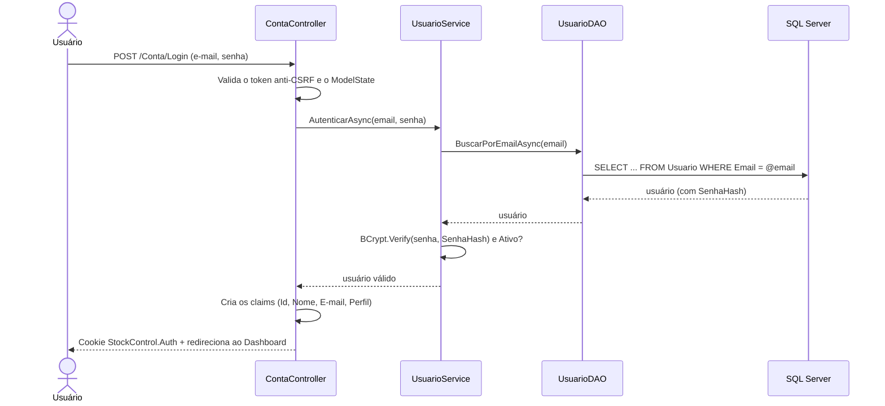

# 5. Autenticação e segurança

## 5.1 Autenticação

O sistema usa **dois mecanismos de autenticação**, um para cada tipo de cliente:

| Cliente | Mecanismo | Por quê |
|---|---|---|
| **Sistema web** (navegador) | **Cookie** de autenticação | O navegador envia o cookie automaticamente em cada página; é o padrão para sites MVC. |
| **App mobile** (API) | **Token JWT** (*JSON Web Token*) | O app guarda o token e o envia no cabeçalho `Authorization: Bearer ...`; é o padrão para APIs consumidas por aplicativos. |

### Login no sistema web (cookie)



Configuração do cookie (`Program.cs`):

| Opção | Valor | Motivo |
|---|---|---|
| `HttpOnly` | `true` | JavaScript não consegue ler o cookie, o que protege contra roubo de sessão via XSS. |
| `SameSite` | `Lax` | O cookie não é enviado em requisições POST vindas de outros sites (ajuda contra CSRF). |
| `ExpireTimeSpan` | 8 horas | Duração de um turno de trabalho. |
| `SlidingExpiration` | `true` | A sessão é renovada enquanto o usuário está usando o sistema. |
| `LoginPath` / `AccessDeniedPath` | `/Conta/Login` / `/Conta/AcessoNegado` | Redireciona automaticamente quem não está logado ou não tem permissão. |

Mais cuidados no login:
- **Mensagem genérica** ("E-mail ou senha inválidos"), para não revelar se o e-mail existe.
- Usuários **inativos** não conseguem entrar.
- Depois do login, o usuário volta para a página que tentou abrir, mas só se o endereço for do próprio sistema (`Url.IsLocalUrl`). Isso impede o golpe de *open redirect*, que mandaria o usuário para um site falso.
- O logout é um **POST** com token anti-CSRF, para que outro site não consiga deslogar o usuário.

### Autenticação na API (JWT)
O app faz login em `POST /api/auth/login` e recebe um token JWT assinado com HMAC-SHA256, válido por 8 horas. O token vai no cabeçalho `Authorization: Bearer {token}` de todas as requisições. A API confere assinatura, emissor, público e validade; um token adulterado ou expirado recebe **401**. Detalhes em [06-api-rest.md](06-api-rest.md#64-autenticação-com-jwt).

## 5.2 Autorização (perfis de acesso)

Depois de saber **quem** é o usuário (autenticação), o sistema verifica **o que ele pode fazer** (autorização). O perfil fica gravado no cookie como *claim* de papel (`Role`) e é verificado com atributos nos Controllers:

```csharp
[Authorize]                              // qualquer usuário logado
public class ProdutosController : Controller

[Authorize(Roles = "Admin,Gerente")]     // só Admin e Gerente
public class CategoriasController : Controller

[AllowAnonymous]                         // exceção: tela de login
public IActionResult Login()
```

| Recurso | Admin | Gerente | Operador |
|---|---|---|---|
| Dashboard | ✅ | ✅ | ✅ |
| Consultar produtos | ✅ | ✅ | ✅ (só ativos) |
| Cadastrar/editar/excluir produtos | ✅ | ✅ | ❌ |
| Categorias e fornecedores | ✅ | ✅ | ❌ |
| Registrar entradas e vendas | ✅ | ✅ | ✅ |
| Gerenciar usuários (funcionários) | ✅ | ❌ | ❌ |
| Editar dados do estabelecimento | ✅ | ❌ | ❌ |

A verificação é feita **no servidor**. Esconder o botão na tela é só conveniência: mesmo digitando o endereço ou enviando um POST manualmente, o usuário sem permissão recebe "Acesso negado".

## 5.3 Isolamento entre estabelecimentos

Como vários mercadinhos usam o mesmo sistema e o mesmo banco, a segurança mais importante é que **um nunca veja os dados do outro**. A proteção é feita em três camadas:

| Camada | Como protege |
|---|---|
| **Banco** | As procedures recebem `@EstabelecimentoId` e recusam produto ou usuário de outro estabelecimento. |
| **Entity Framework** | Filtro automático (*Global Query Filter*) em todas as consultas: `WHERE EstabelecimentoId = @estabelecimentoDoUsuario`. Não depende de cada tela lembrar de filtrar. |
| **Sessão** | O estabelecimento fica gravado no cookie criptografado (web) e no token JWT assinado (API). O usuário não consegue trocá-lo: alterar o cookie o invalida, e alterar o token quebra a assinatura. |

Testes de isolamento (ver [07-testes-realizados.md](07-testes-realizados.md)):
- o usuário do Mercadinho B que tenta abrir pelo endereço um produto, categoria ou usuário do Mercadinho A recebe **404** (para ele, o registro não existe);
- a tentativa de vender pela API um produto de outro estabelecimento é recusada.

Mais cuidados:
- **Cadastro aberto, mas controlado:** qualquer pessoa pode cadastrar um estabelecimento **novo**. Ninguém consegue se cadastrar dentro de um estabelecimento que já existe: o CNPJ repetido é recusado e o sistema orienta a pedir o acesso ao administrador. Funcionários só são criados pelo Admin do próprio estabelecimento.
- **Sessões antigas:** um cookie sem o estabelecimento (de antes dessa versão) é descartado automaticamente (`OnValidatePrincipal`), e o usuário entra de novo.

## 5.4 Senhas

- As senhas **nunca** são gravadas em texto puro. É gravado apenas o **hash BCrypt** (`BCrypt.Net-Next`), por exemplo `$2a$11$iGuz4A17...`.
- O BCrypt gera um *salt* aleatório para cada senha: duas pessoas com a mesma senha têm hashes diferentes.
- O fator de custo 11 deixa cada tentativa propositalmente lenta, o que dificulta ataques de força bruta.
- No login, `BCrypt.Verify` calcula o hash da senha digitada e compara com o hash salvo. A senha original não pode ser recuperada a partir do hash.
- Tamanho mínimo: 6 caracteres.
- **Troca da própria senha ("Minha conta"):** exige a **senha atual**. Assim, alguém que encontre um computador deixado logado não consegue trocar a senha do dono da sessão. A nova senha precisa ser diferente da atual.

## 5.5 Proteção contra CSRF

*Cross-Site Request Forgery* é quando um site malicioso faz o navegador do usuário logado enviar um formulário para o nosso sistema sem ele saber (por exemplo, excluir um produto).

Proteção usada:
- Todo `<form method="post">` gerado pelos *Tag Helpers* inclui um campo oculto `__RequestVerificationToken`.
- Toda ação POST tem o atributo `[ValidateAntiForgeryToken]`, que rejeita o envio sem o token correto.
- O cookie com `SameSite=Lax` reforça a proteção.
- Exclusões nunca são feitas por GET (link): sempre passam por uma página de confirmação com formulário POST.

## 5.6 Validação de entrada

A validação acontece em **três níveis**:

| Nível | Exemplo |
|---|---|
| **1. ViewModel** (*DataAnnotations* + `ModelState`) | `[Required]`, `[StringLength(120)]`, `[RegularExpression(@"^\d{1,20}$")]` no código de barras, `[EmailAddress]`, `[Range]`. |
| **2. Service** (regra de negócio) | CNPJ com dígitos verificadores válidos, código de barras único, saída não maior que o estoque. |
| **3. Banco de dados** | `CHECK`, `UNIQUE`, `FOREIGN KEY` e as validações da procedure. |

Os ViewModels também impedem o **overposting**: só os campos previstos são aceitos. O estoque, por exemplo, não pode ser alterado pelo formulário de produto.

## 5.7 Outras proteções

| Ameaça | Proteção |
|---|---|
| **SQL Injection** | O Entity Framework usa consultas parametrizadas. As procedures são chamadas com strings interpoladas que o EF converte em parâmetros (`@p0`, `@p1`...). Nenhum SQL é montado concatenando texto digitado pelo usuário. |
| **XSS** (*Cross-Site Scripting*) | O Razor codifica (*HTML encode*) automaticamente todo dado exibido com `@`. Um nome de produto como `<script>` aparece como texto, sem ser executado. |
| **Dados em trânsito** | `UseHttpsRedirection` redireciona HTTP para HTTPS; em produção, `UseHsts` obriga o navegador a usar sempre HTTPS. |
| **Detalhes de erro expostos** | Em produção, erros mostram uma página genérica, sem detalhes técnicos. |
| **Concorrência no estoque** | A procedure bloqueia a linha do produto durante a venda (`UPDLOCK, HOLDLOCK`), para que duas vendas simultâneas não deixem o estoque negativo. |
| **Perda de histórico** | Produtos com movimentações são desativados, não excluídos. Mudanças de preço e exclusões ficam registradas em `LogAuditoria`, que o Admin consulta na tela **Auditoria** (só leitura: o sistema não permite editar nem apagar o histórico). |
| **Envio duplicado** | O botão do formulário é desabilitado depois do primeiro clique, evitando registrar a mesma venda duas vezes. |
| **Ficar sem administrador** | O sistema impede desativar ou rebaixar o último Admin ativo. |
